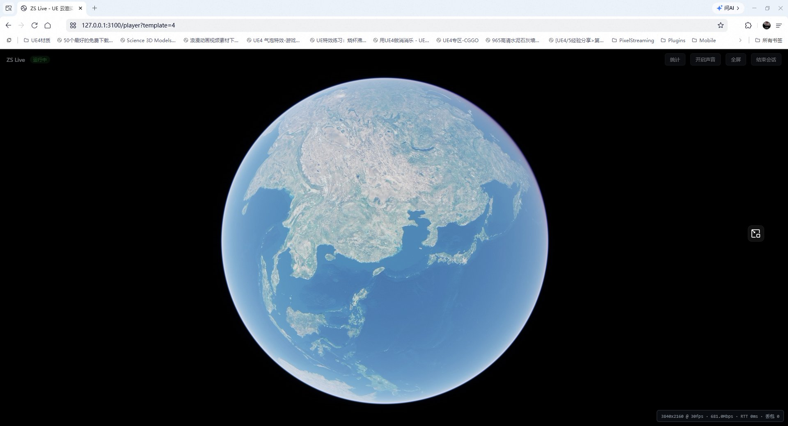
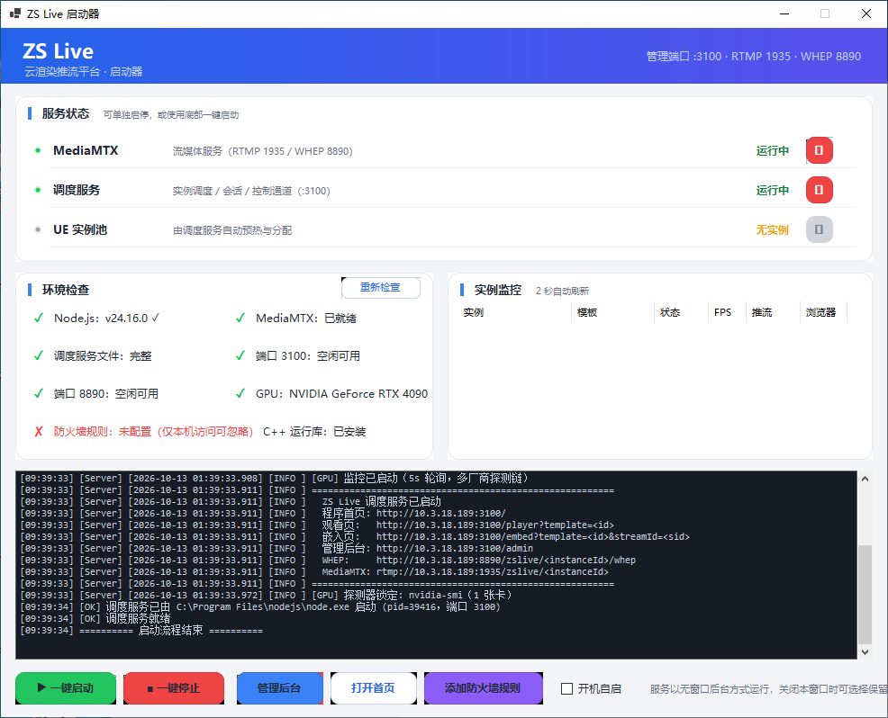
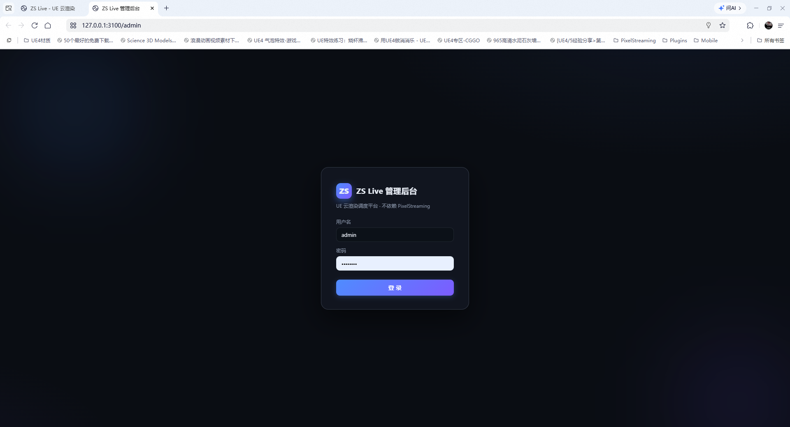
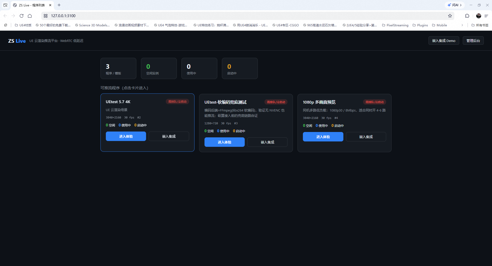
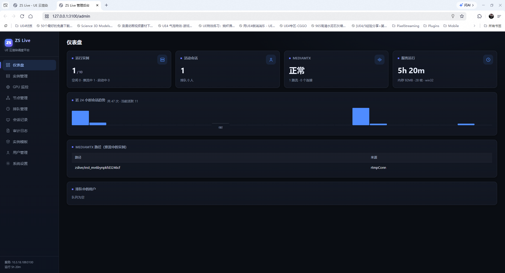
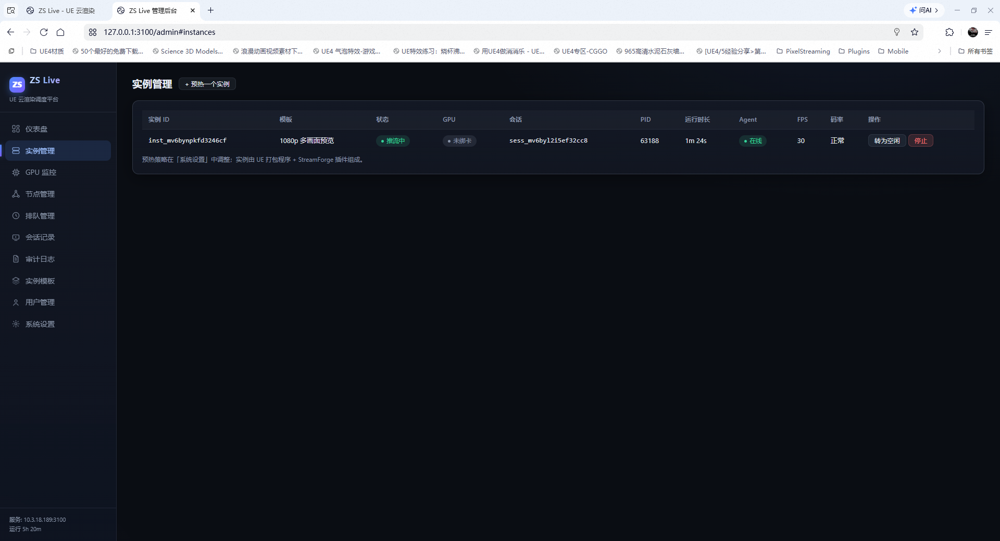
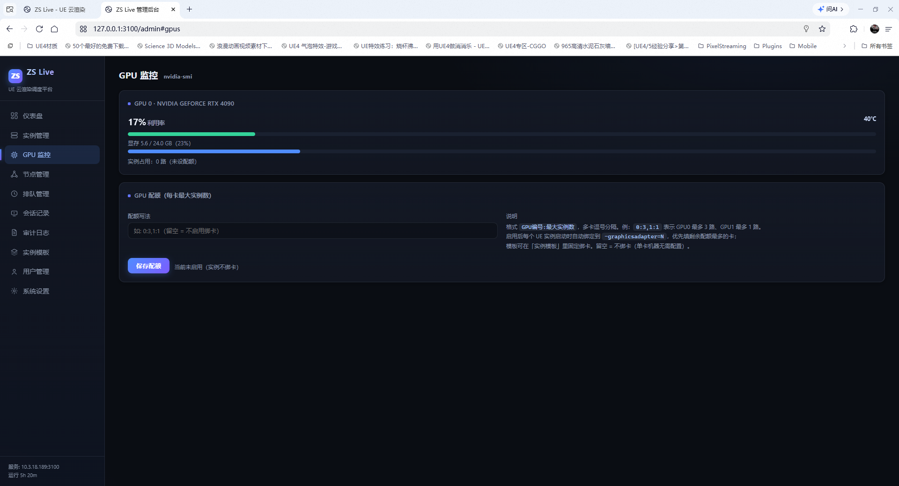
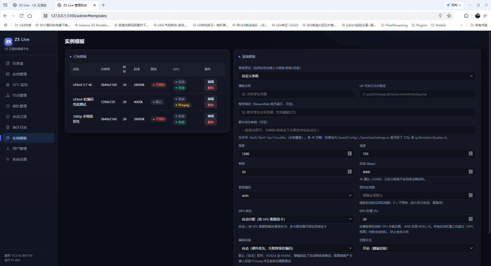
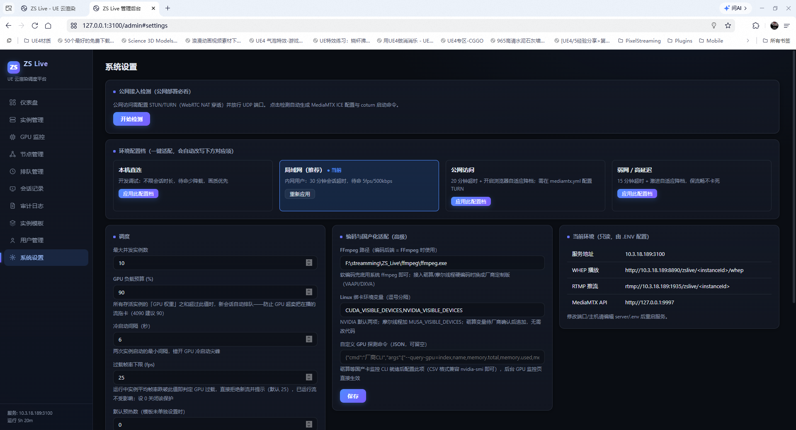
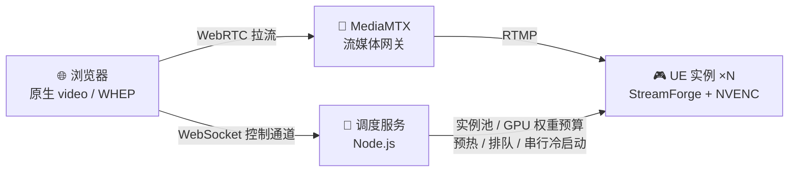

<div align="center">

# 🎮 ZS Live

**把 Unreal Engine 画面，变成一个链接。**

*4K 云渲染实时串流平台 · 浏览器即开即玩 · 无需下载 · 无需插件*

[](https://www.unrealengine.com)
[]()
[]()
[]()
[](./LICENSE)

<br>



**▲ 这不是视频，是浏览器里实时渲染、可实时操控的 Unreal Engine 画面（4K / 30fps / WebRTC）**

</div>

---

## 💡 一句话说清楚

> 你的 UE 场景跑在 GPU 服务器上，客户的浏览器只是一个"遥控器"。
> **发一个链接，对方就能走进你的 3D 世界** —— 看房、看车、看工厂、数字孪生、虚拟展厅，全部零安装。

| | 传统方案 | ZS Live |
|---|---|---|
| 客户打开方式 | 下载几 GB 安装包 | **点开链接即用** |
| 画面质量 | 受客户硬件限制 | **云端 4K 渲染，与设备无关** |
| 场景保护 | 打包文件可被拷贝破解 | **场景永远在服务器，源码级保密** |
| 硬件要求 | 客户需要好显卡 | **手机 / 平板 / 老电脑都能流畅跑** |

## ✨ 为什么选 ZS Live

- ⚡ **真·实时**：WebRTC (WHEP) 直连 + NVENC 硬编码，操作延迟毫秒级；切后台 / 切标签页回来**按需关键帧，秒级恢复满帧**
- 🖥️ **4K 视听**：单张 RTX 4090 实测可**并行 6 路 4K/30fps**（GPU 权重预算准入，绝不超卖卡死）
- 🧩 **UE 插件级集成**：StreamForge 插件快速接入你的 UE 工程——推流、编码、控制通道全搞定，场景逻辑零改动
- 🎛️ **全家桶开箱即用**：启动器一键拉起 MediaMTX + 调度服务 + UE 实例池，环境自检、防火墙一键配置
- 📊 **专业级运维后台**：实例池 / GPU 监控 / 会话曲线 / 多机节点 / 模板编辑 / 排队管理，一屏尽览
- 🔥 **预热秒开**：实例预热池 + 冷启动串行化，客户点开链接约 **4 秒进入画面**
- 🏭 **国产化适配**：x264 软编回退、多厂商显卡探测，不绑死单一硬件生态
- 🔐 **商业授权体系**：内置 License Key 校验，评估 / 专业 / 企业分档，保护你的每一分投入

## 📸 界面一览

| 一键启动器 | 管理后台 |
|:---:|:---:|
|  |  |
| *MediaMTX + 调度 + 实例池一键拉起，环境自检、GPU 自动识别* | *暗色系管理后台，专业感拉满* |

| 首页 · 模板广场 | 运维仪表盘 |
|:---:|:---:|
|  |  |
| *多个体验入口，客户点一下就进入云渲染* | *实例 / 会话 / MediaMTX / 运行时长，24h 会话曲线* |

| 实例管理 | GPU 监控 |
|:---:|:---:|
|  |  |
| *每个实例的 GPU / FPS / 运行时长一目了然，支持强制回收* | *多卡利用率 / 显存 / 温度实时监控，GPU 权重预算防超卖* |

| 模板编辑器 | 系统设置 |
|:---:|:---:|
|  |  |
| *分辨率 / 帧率 / 码率 / 编码器 / GPU 权重，全部可视化配置* | *防火墙一键配置、编解码与国产化适配、端口暴露向导* |

## 🏗️ 架构



- **推流链路**：UE 实例（NVENC 硬编码）→ RTMP → MediaMTX → WHEP → 浏览器原生播放
- **控制链路**：浏览器 WebSocket → 调度服务 → UE 控制通道（键鼠交互、`sf_` 命令透传、按需关键帧）
- **调度内核**：GPU 权重预算准入 + 冷启动串行化 + 预热池冷却回收，多卡 / 多机弹性扩容

## 🚀 快速体验（评估模式）

```text
1. 准备一台带 NVIDIA 显卡的 Windows 机器（Node.js + UE 运行时）
2. 双击启动器，一键启动
3. 浏览器打开 http://本机IP:3100 —— 点"进入体验"，约 4 秒后你就在 3D 世界里
```

> 无 License Key 时自动进入**评估模式**（单实例），功能完整，可跑通全流程验证。

## 💼 商业授权与三种客户形态

ZS Live 采用 **Source-Available（源码可见）** 模式：本仓库公开完整产品代码与接口层，
调度引擎、UE 插件、授权验签与签发工具均以源码形式提供，按授权档位与**交付形态**区分使用权限。
详见 [LICENSE](./LICENSE)：未经商业授权，**禁止商用、禁止部署对外服务、禁止再分发**。

### 三种客户形态

| 形态 | 交付物 | 授权方式 | 实例限制 |
|---|---|---|---|
| 🆓 **试用** | 完整部署包（公开源码自部署，或作者提供的评估包） | 不签发 token；后台验证默认开启但无有效 token | **评估模式：最多 1 个并发实例**，功能完整可跑通 |
| 🏅 **应用购买** | 部署包（`server/` 调度服务 + `web/` 后台 + `ue-plugin/`） | 作者用 `tools/LicenseTool` 签发 token（自定义**实例数 / 有效期**），客户在后台「授权管理」粘贴启用 | 按 token 档位（实例数 / 时长）；到期或超限回到评估模式 |
| 💎 **源码购买** | 源码交付（运行 `node scripts/build_source_edition.js` 生成） | **不含密钥核对模块**——仅提供推流（`server/`）+ UE 插件（`ue-plugin/`），自动降级为不限实例 | 源码形态，按源码许可条款使用 |

> 授权校验基于 **RSA 非对称签名**：公开仓库仅含**验签公钥**（`server/license.pub.pem`），
> **签名私钥由作者保管（仅存于私有仓库）**。客户即使用源码自部署，也无法伪造授权 token。

### 档位与交付

| 档位 | 适用场景 | 包含内容 |
|---|---|---|
| 🆓 **评估版** | 内部验证 / POC | 完整部署包 · 单实例 · 全功能可用 |
| 🏅 **专业版** | 单机商用部署 | 多实例授权 token · 部署支持 · 一年更新 |
| 💎 **企业版** | 多机集群 / OEM 贴牌 / 源码交付 | 集群调度授权 · 源码交付 · 定制适配 · 优先技术支持 |

**为什么值得现在入手？**

- ✅ 客户体验立刻上一个档次：从"发安装包"变成"发链接"
- ✅ 你的 UE 场景从此**带不走、拷不掉**——这是最彻底的场景保护
- ✅ 一张 4090 顶一个机房：6 路 4K 并行，边际成本极低
- ✅ 授权体系内置，**RSA 非对称签名——客户拿到部署包也无法伪造授权**，商业模式稳得住

<div align="center">

**📮 商务合作 & 获取报价**

**邮箱：2458830486@qq.com（刘华西）** · 或 [提交 Issue](https://github.com/TIANTIANKAIXIN-STAR/ZS_Live/issues) 留下您的需求

*支持远程演示 —— 给您一个链接，眼见为实。*

</div>

### 本仓库包含什么 / 不包含什么

| 公开（本仓库） | 说明 |
|---|---|
| `server/` | Node.js 调度服务（实例池 / GPU 准入 / 授权验签等），源码可见 |
| `web/` | 前端播放器 / 嵌入页 / 管理后台（含「授权管理」页）/ SDK |
| `ue-plugin/` | UE 推流插件（StreamForge），含 Private 实现 |
| `scripts/` | `gen_license.js`（作者签发）、`build_source_edition.js`（源码交付生成器） |
| `tools/LicenseTool/` | 授权签发 EXE 工具（.NET 源码） |
| `docs/` 技术接口文档 | [控制通道协议](docs/控制通道协议.md)、[UE 插件集成指南](docs/UE插件集成指南.md) |
| `README.md` / `LICENSE` | 说明与许可 |

| **仅存于私有仓库（不公开）** | 说明 |
|---|---|
| `server/license.priv.pem` | RSA 签名私钥——授权 token 的唯一签发根；泄露须重生成密钥对并给所有客户重签 |
| `docs/internal/` | 作者内部文档（授权管理规范、密钥安全红线等） |
| `UETest/` `ffmpeg/` `mediamtx/` `launcher/` `installer/` | 示例 UE 工程 / 运行时二进制 / 启动器与安装包构建产物（体积大，不入公开库） |

> 未授权环境下即使自部署源码，也会被强制限制在**评估模式（最多 1 个并发实例）**，
> 且商业部署仍需购买授权（见 LICENSE）。

## ❓ FAQ

**Q：客户端需要装什么？**
A：什么都不用装。Chrome / Edge 等现代浏览器打开链接即可，手机浏览器同样支持。

**Q：我的 UE 工程要改多少代码？**
A：集成 StreamForge 插件 + 一个启动参数，无需改动场景逻辑；协议见 [docs/控制通道协议.md](docs/控制通道协议.md)。

**Q：一台服务器能带多少路？**
A：RTX 4090 实测 4K/30fps 每路约占 GPU 权重 16%，单卡 6 路并行；1080p 场景可 4-6 路同屏分屏。多卡与多机集群可线性扩展。

**Q：和"录屏 + 视频流"方案有什么区别？**
A：ZS Live 是**双向实时**的——客户可以操控（漫游 / 点击 / 驾驶），而不是看录播。

## 📄 License 与商标

本项目为 **Source-Available**（源码可见，非 OSI 开源）。查看 [LICENSE](./LICENSE) 了解权利与限制：
未经商业授权，**禁止商用、禁止部署对外服务、禁止再分发、禁止去除版权 / 商标**。
**ZS Live™** 为 Liu Huaxi (刘华西) 个人所有，未经书面许可不得使用。

---

<div align="center">

**ZS Live** · 云渲染实时串流平台 · © 2026 Liu Huaxi (刘华西) 保留所有权利

</div>

## 技术对比

- [ZS_Live 与 Unreal 像素流送（Pixel Streaming）技术对比](docs/compare-pixelstreaming.md)
