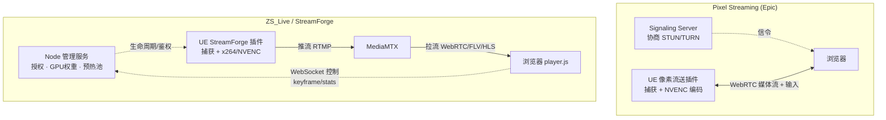

# ZS_Live / StreamForge 与 Unreal 像素流送（Pixel Streaming）技术对比

> 面向技术选型与对外说明：解释 ZS_Live 自研的 StreamForge 推流方案与 Epic 官方像素流送在架构与技术点上的差异，以及 ZS_Live 的优势定位。

## 一句话本质区别

**像素流送** 是为「每用户实时交互」设计的 **WebRTC 直连**方案；**ZS_Live（StreamForge）** 是为「一对多直播 + 服务器端集中编排」设计的 **RTMP/RTSP 转发 + 浏览器拉流**方案。两者都把渲染放在远端 GPU、浏览器只负责解码，但**传输协议、控制方式、并发模型**完全不同。

## 架构对照

- 实线 = 媒体 / 数据通路
- 虚线 = 信令 / 控制通路

## 技术点逐项对照

| 技术点 | Pixel Streaming（Epic） | ZS_Live / StreamForge（本项目） |
| --- | --- | --- |
| **传输协议** | WebRTC P2P（SRTP 媒体 + datachannel 输入），浏览器与 UE 直连 | UE → **MediaMTX**（RTMP / RTSP）→ 浏览器**拉流**（WebRTC / FLV / HLS） |
| **编码** | NVENC 硬件编码，由 WebRTC 栈自动管理 | StreamForge 显式调用 **x264 `-tune zerolatency` / NVENC**，并做 `gpu_weight` 预算 |
| **控制 / 输入回传** | WebRTC **datachannel** 双向低延迟输入（鼠标 / 键盘 / 触摸） | 独立 **WebSocket 控制通道**（`sf_request_keyframe`、stats、实例生命周期） |
| **交互模型** | **1 个 UE 进程 = 1 个交互会话**；多人看同一画面需 SFU 广播「同一直播源」 | **单 GPU 多路并发**（RTX 4090 实测 6 × 4K30 ≈ 93% 权重），服务端做实例编排 |
| **延迟定位** | 追求 < 100ms 可精确操控 | 「直播级」亚秒延迟，适合观看 / 轻交互而非逐帧精确操作 |
| **NAT / 防火墙 / 分发** | 需 STUN / TURN 或 SFU 穿透，直连易被网络环境阻断 | 走标准 HTTP / RTMP 出 MediaMTX，易过防火墙、上 CDN / 边缘节点 |
| **播放端** | 官方 `ue.js`，向 UE 注入输入 | 自写 `player.js`：`visibilitychange` 暂停解码、`textContent` 刷新 stats、keyframe 重请求 |
| **多租户 / 鉴权** | 官方不负责，需自行搭建 | 内置 **license 验签 + 集群 master / worker 授权台账 + `gateCheck` 硬闸** |
| **来源 / 可控性** | Epic 官方闭源插件 | 自研 StreamForge（源码可见），编码与协议均可定制 |

## 三个核心差异（也是本项目选自研路线的根本原因）

1. **并发维度不同**。像素流送的 SFU 只能把「同一个 UE 实例的画面」广播给多个观众——本质是**一源多播**；而 ZS_Live 既能一源多播（一路 UE → MediaMTX → N 个拉流端），又能在**一块 GPU 上跑多路彼此独立的 UE 实例**（不同场景 / 不同会话），靠服务端 `gpu_weight` 准入、预热池、冷启动串行化来统一调度。这正是像素流送的薄弱环节，也是本平台的核心价值。

2. **控制通道解耦**。像素流送把媒体和输入都塞进同一个 WebRTC 连接（datachannel）；ZS_Live 把媒体（MediaMTX 拉流）与信令（WebSocket）分开，因此浏览器后台标签页可以纯粹「停解码不拆连接」、断线重连只发一个 keyframe 请求即可续上——这也是多开标签页不卡顿的关键机制。

3. **集中编排 + 授权**。本项目用 `Node 管理服务` 统一管授权、GPU 预算、实例生命周期、集群主从；像素流送把这些全交给部署者自己用 Cirrus / Matchmaker / SFU 拼装。

## 两者的收敛点（其实很像）

- 都是「远端 GPU 渲染 → 编码 → 浏览器解码」，客户端零安装；
- 都使用 **NVENC 硬件编码**；
- 都**不下发 UE 资产 / 逻辑到客户端**（IP 保护，客户端只拿到视频帧）；
- 都能在手机 / 低配机上运行高画质 UE 内容。

## 适用场景与定位

- **像素流送适合**：单人精准操控某一个 UE 实例（虚拟座舱、交互式产品 demo、需要实时键鼠反馈的体验）。
- **ZS_Live 适合**：一对多直播分发、单 GPU 高密度多实例、需要集中授权与生命周期管理的渲染分发平台。

## 小结

ZS_Live 不是「另一个像素流送」，而是**把 UE 当作可被集中调度的直播渲染集群**——MediaMTX 作分发层、Node 作编排 / 鉴权层、StreamForge 作采集编码层。像素流送擅长「一对一精准交互」，ZS_Live 擅长「一对多 + 高密度多实例分发」，两者定位互补。若未来某个场景需要「单人精准操控某一路」，可在 StreamForge 上把 WebSocket 控制通道升级为低延迟输入回传，即可在现有架构内补齐像素流送那条能力，而无需引入整套 WebRTC P2P 栈。
